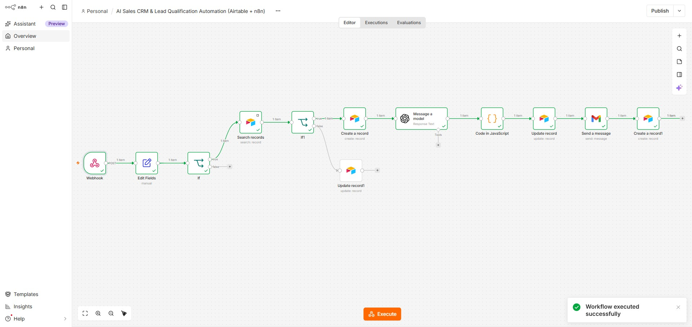
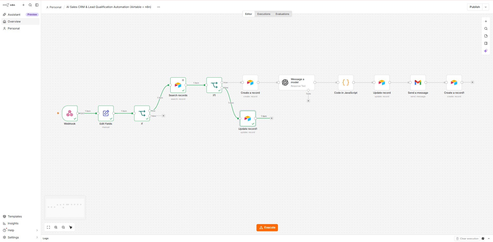
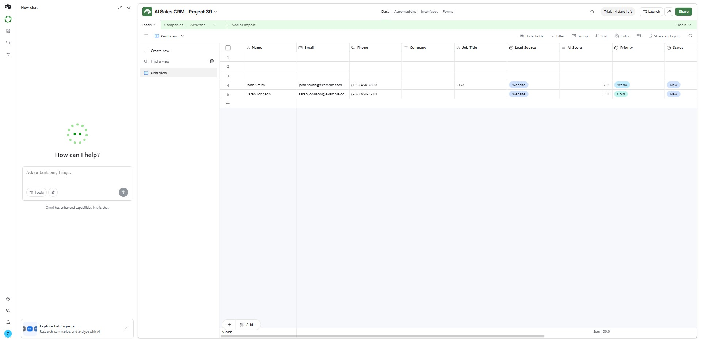
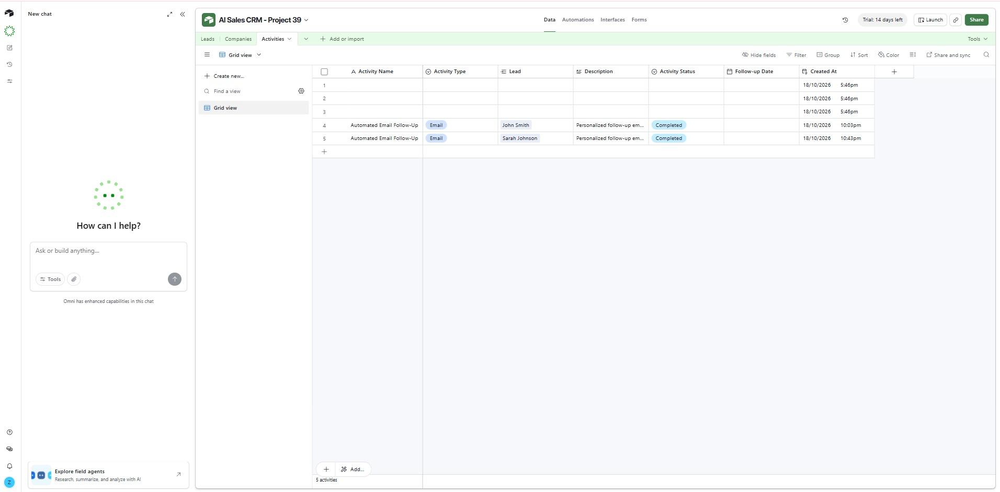

# AI Sales CRM & Lead Qualification Automation (Airtable + n8n)

## Project Overview

An AI-powered sales CRM and lead qualification automation built using **n8n, Airtable, OpenAI, and Gmail**.

This project demonstrates how businesses can automate incoming lead processing, organize customer information, qualify leads using AI, send automated email responses, and track sales activities.

## Key Features

- **Webhook Lead Capture:** Receives incoming lead information through an n8n webhook.
- **Duplicate Lead Detection:** Searches Airtable using the lead's email address to identify existing records.
- **CRM Record Management:** Creates new lead records or updates existing leads in Airtable.
- **AI Lead Qualification:** Uses OpenAI to analyze lead information and generate qualification results.
- **Lead Scoring:** Stores AI-generated lead scores and priority classifications.
- **Automated Email Responses:** Sends follow-up emails using Gmail.
- **Activity Tracking:** Records completed email follow-up activities in Airtable.
- **Workflow Branching:** Uses IF conditions to handle different lead-processing scenarios.

## Technology Stack

- n8n — Workflow automation
- Airtable — CRM database and activity tracking
- OpenAI — AI-powered lead analysis
- Gmail — Automated email communication
- JavaScript — Workflow data processing
- Webhooks — Lead intake

## Workflow Process

1. Receive lead information through a webhook.
2. Prepare and validate incoming data.
3. Search Airtable for an existing lead.
4. Route the workflow based on the duplicate-check result.
5. Create or update the lead record.
6. Analyze new leads using OpenAI.
7. Process and store AI qualification results.
8. Send an automated email response.
9. Create a CRM activity record for the completed follow-up.

## Project Screenshots

### 1. Successful Workflow Execution

### 2. Duplicate Lead Detection

### 3. Airtable CRM — Leads

### 4. Airtable CRM — Activities

## Testing

The workflow was tested with sample leads, including:

- **John Smith:** AI qualification score of 70, classified as Warm.
- **Sarah Johnson:** AI qualification score of 30, classified as Cold.
- Duplicate email detection and existing-record updates.
- Successful automated Gmail follow-up.
- Airtable activity records linked to leads.

## Business Use Cases

This automation can support:

- Sales teams
- Marketing agencies
- Lead generation businesses
- CRM management workflows
- Customer inquiry processing

## Project Type

**Independent Portfolio Project — Demonstration and Testing**

Built to demonstrate practical experience with AI automation, CRM integrations, webhooks, API-connected workflows, and sales process automation.

## Developer

**Zoraiz Ali**

AI Automation & n8n Workflow Developer

[GitHub Portfolio](https://github.com/zoraiz-ai)
